# Polyglow

**Learn Spanish in five minutes a day.** Polyglow is a mobile-first, installable
language-learning app (PWA) with short game-like lessons, XP, streaks, hearts and a
skill path. Our guide is **Lumi**, a small paper lantern whose glow grows with your streak.

> Built by an autonomous team of AI agents (product, tech lead and three developers)
> that plans, builds, reviews and merges every night. This README is refreshed by the
> nightly run: screenshots and recordings are captured from the real app on `main`.

**Last updated:** 2026-11-11 · **Version:** 0.0.0 (pre-release) · **Course:** English → Spanish, Unit 1 (5 lessons)

---

## What you can do today (on `main`)

### First launch: onboarding

Pick a course and a daily goal. No account needed: progress is saved on the device.

<p>
  
</p>

| Welcome                                                                                                  | Choose a course                                                                                        | Choose a daily goal                                                                                            |
| -------------------------------------------------------------------------------------------------------- | ------------------------------------------------------------------------------------------------------ | -------------------------------------------------------------------------------------------------------------- |
| 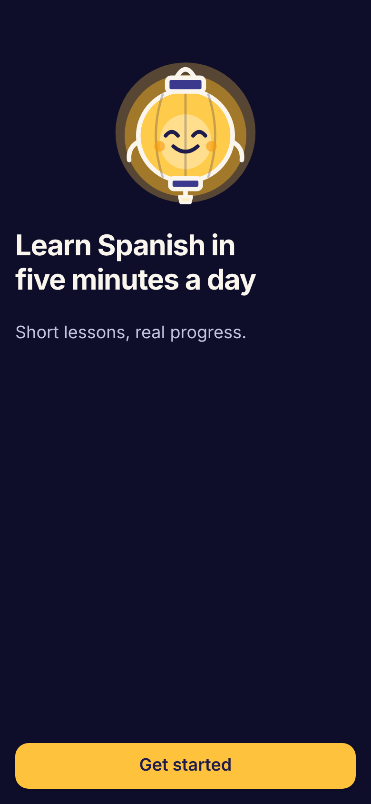 | 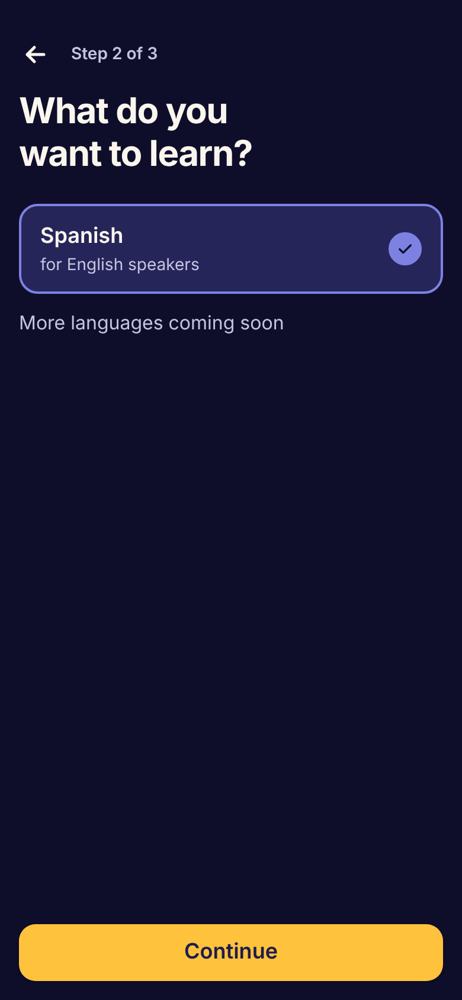 | 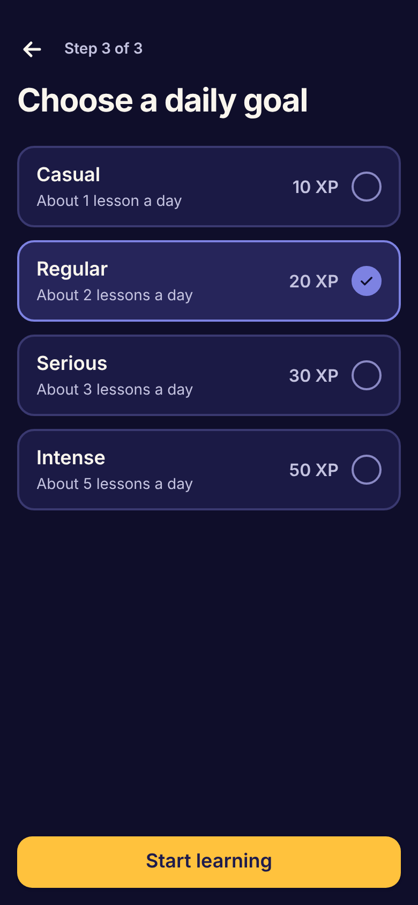 |

[▶ Watch in full quality (MP4)](docs/media/onboarding.mp4)

### App shell, navigation and offline support

Bottom navigation (Learn · Profile), an installable PWA with a service worker, and an
offline banner. The Learn and Profile tabs still show placeholders: the lesson list and
skill path are being wired in (see _Coming next_).

| Learn                                                                      | Profile                                                                        | Offline                                                                      | Back online                                                                   | Page not found                                                    |
| -------------------------------------------------------------------------- | ------------------------------------------------------------------------------ | ---------------------------------------------------------------------------- | ----------------------------------------------------------------------------- | ----------------------------------------------------------------- |
| 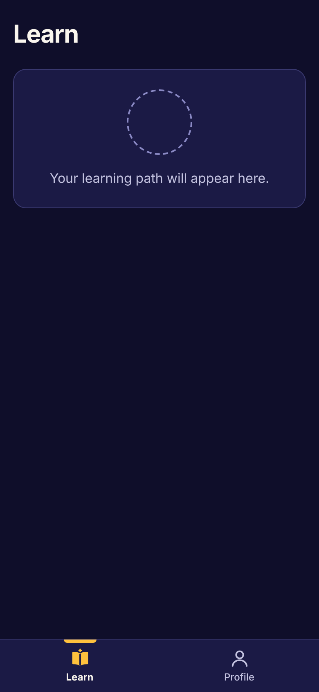 | 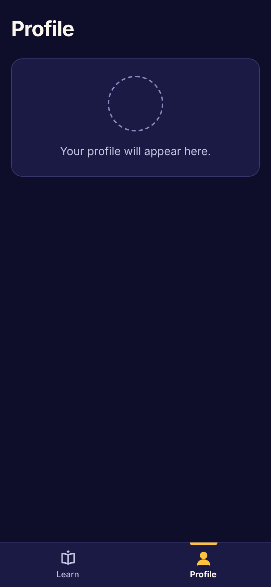 | 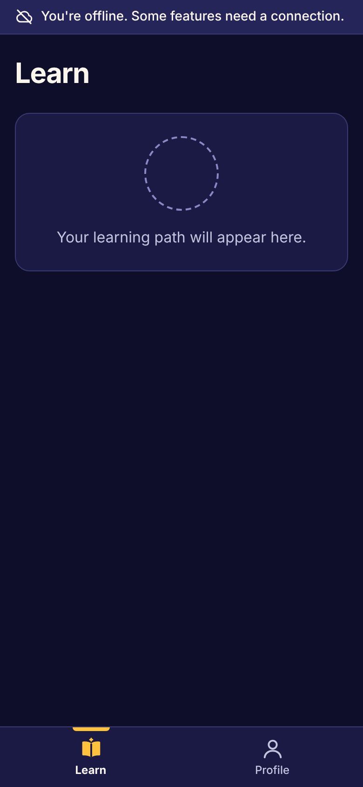 | 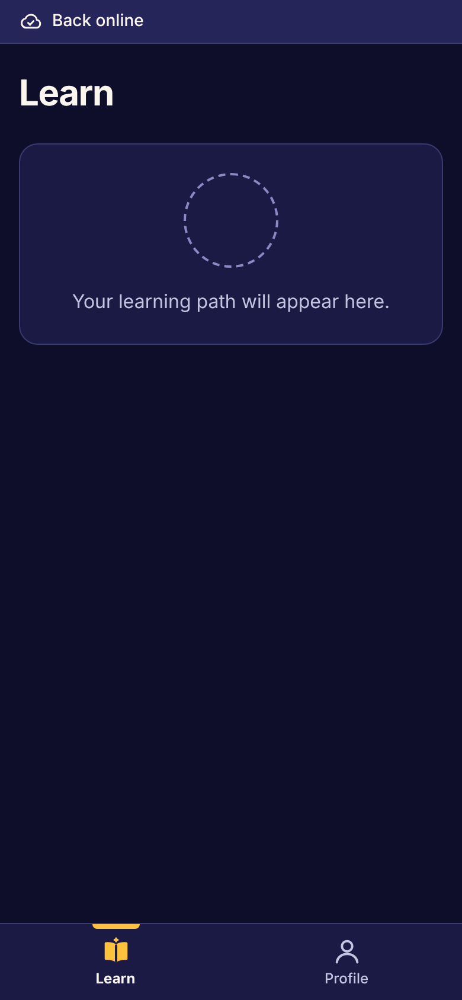 | 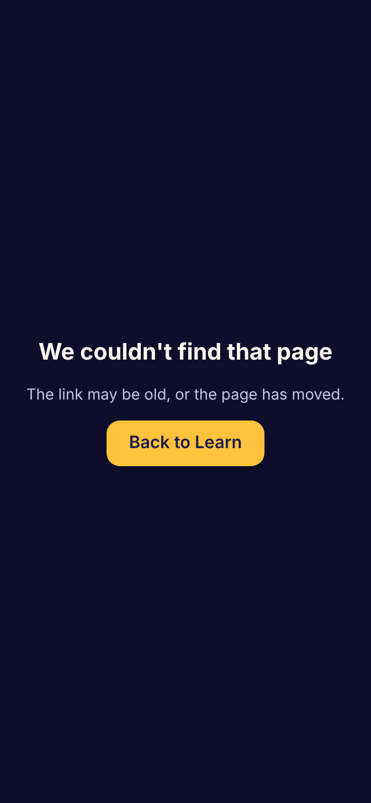 |

<p>
  
  &nbsp;&nbsp;
  
</p>

[▶ Tabs (MP4)](docs/media/tabs.mp4) · [▶ Offline (MP4)](docs/media/offline.mp4)

### Built under the hood (merged, not yet on a screen)

- **Lesson engine:** lesson player, feedback panel, results screen, answer checking, and
  four exercise types (multiple choice, word bank, match pairs, listen).
- **Gamification rules:** XP, streaks (time-zone and daylight-saving safe), hearts with
  timed refills, daily goal, skill-path unlocking, the hearts meter.
- **Unit 1 content:** 5 original lessons, 60 exercises, validated against the contracts.
- **Data:** guest profile in IndexedDB (Dexie), TanStack Query cache, Supabase schema with
  row-level security, ready for accounts and sync.

---

## Coming next (built, in review)

These screens come from the `feature/plt-007-course-loading-lesson-route` branch (lesson
route and results saved on the device). They will move up to the section above once
merged.

<p>
  
</p>

| Multiple choice                                                                                                       | Not quite                                                                                                        | Nice work!                                                                                                   | Match pairs                                                                                                |
| --------------------------------------------------------------------------------------------------------------------- | ---------------------------------------------------------------------------------------------------------------- | ------------------------------------------------------------------------------------------------------------ | ---------------------------------------------------------------------------------------------------------- |
| 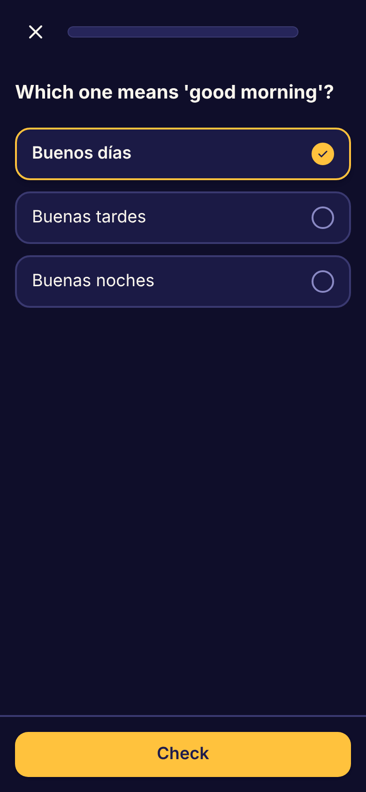 | 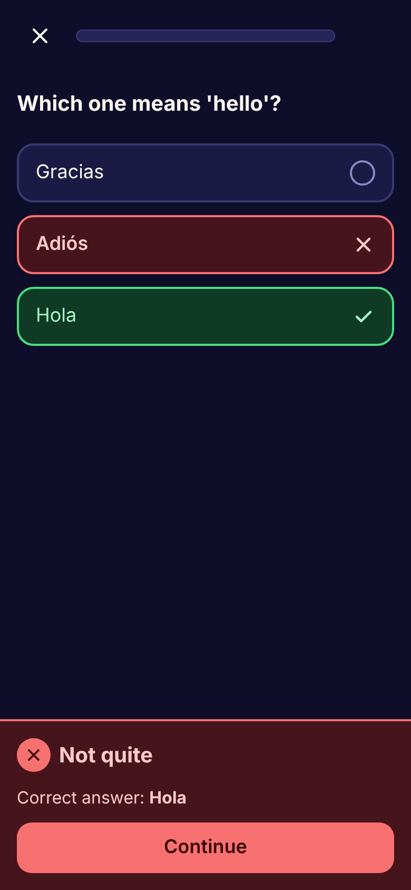 | 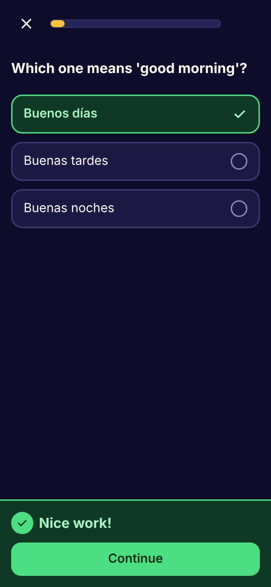 | 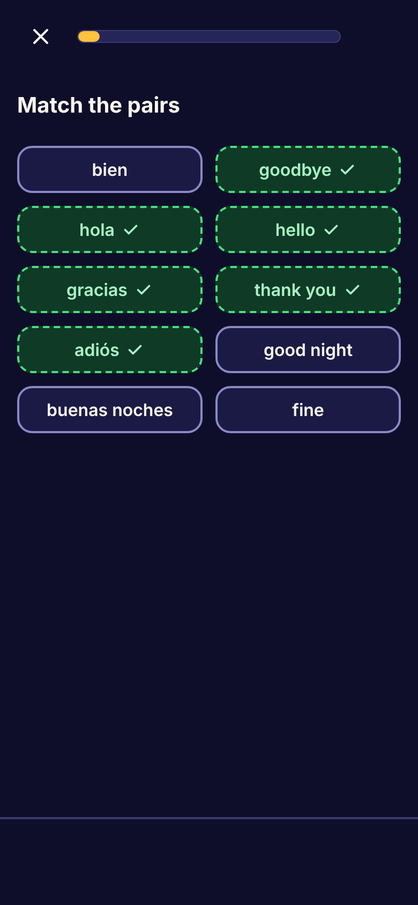 |

| Word bank                                                                                              | Listen                                                                                                   | Lesson complete                                                                                                 | Lesson list                                                                                                                   |
| ------------------------------------------------------------------------------------------------------ | -------------------------------------------------------------------------------------------------------- | --------------------------------------------------------------------------------------------------------------- | ----------------------------------------------------------------------------------------------------------------------------- |
| 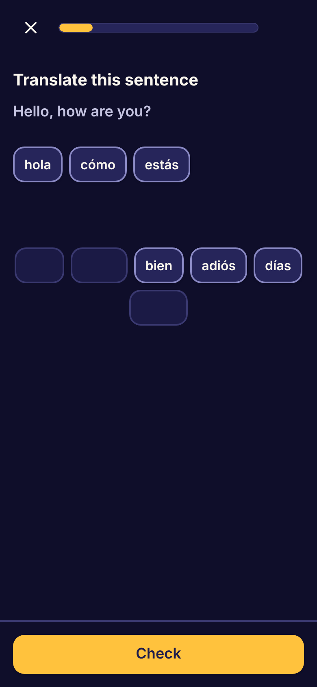 | 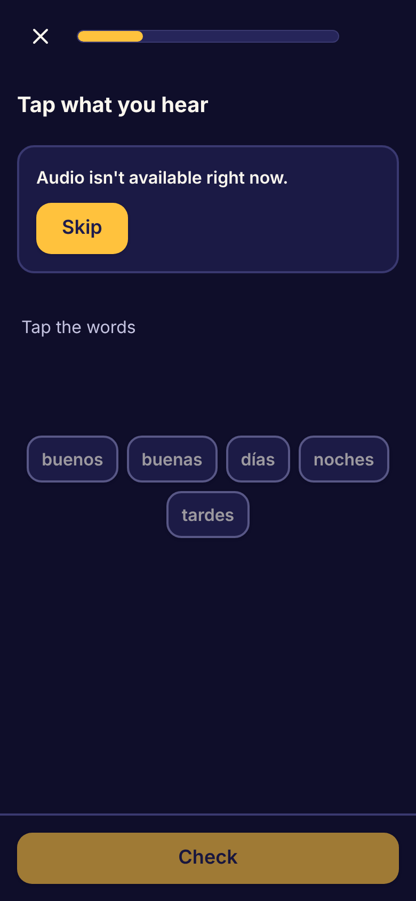 | 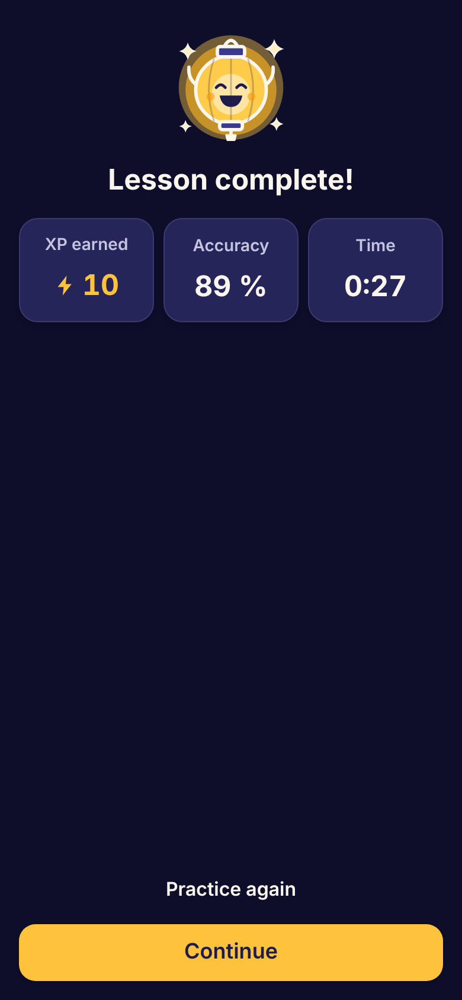 | 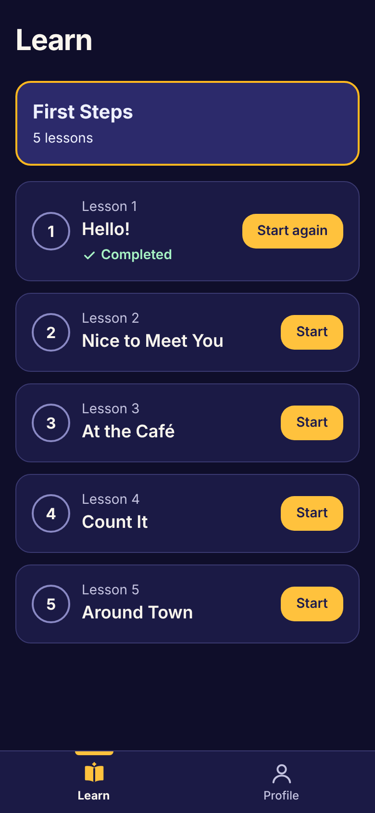 |

[▶ Full lesson (MP4)](docs/media/preview/lesson.mp4)

_The listen exercise shows "Audio isn't available" because the recorded audio files
are not in the repo yet (waiting on a text-to-speech licence decision); learners can skip
it without losing a heart._

Also in progress: the gamification top bar (streak, XP, hearts), streak-aware Lumi,
hearts inside lessons with an out-of-hearts screen, streak and goal rows on the results
screen, and the install/update prompt.

---

## Roadmap

| Version | Goal                                                           | Status                                   |
| ------- | -------------------------------------------------------------- | ---------------------------------------- |
| v0.1.0  | MVP foundation: app shell, PWA, guest mode, onboarding         | almost done (install prompt in progress) |
| v0.2.0  | First playable lesson: lesson engine, 4 exercise types, Unit 1 | in review (lesson route)                 |
| v0.3.0  | Gamification loop: XP, streaks, hearts, daily goal, skill path | in progress                              |
| v0.4.0  | Accounts and sync (Supabase), profile and settings             | planned                                  |
| v1.0.0  | Launch polish: accessibility, performance, e2e coverage        | planned                                  |

Details: [`docs/product/ROADMAP.md`](docs/product/ROADMAP.md) · Live status:
[`docs/STATUS.md`](docs/STATUS.md)

## Tech stack

Next.js (App Router) · React · TypeScript (strict) · Tailwind CSS · Serwist (service
worker) · Dexie (IndexedDB) · TanStack Query · Zustand · Supabase · Zod · Vitest + React
Testing Library · Playwright

## Run it locally

```bash
npm ci
npm run dev          # http://localhost:3000
npm run test         # unit tests
npm run build        # production build (webpack, emits the service worker)
npm run test:e2e     # Playwright end-to-end tests
```

## Updating the screenshots and recordings

```bash
npm run build && npx next start -p 3200 &
BASE_URL=http://localhost:3200 node scripts/readme-media/capture.mjs   # PNGs + recordings
scripts/readme-media/encode.sh                                         # → GIF + MP4
```

Set `CHROMIUM_PATH` to use a specific Chromium, `ONLY=onboarding,lesson` to capture
selected flows, and `MEDIA_DIR=docs/media/preview` to capture an unmerged branch. New
screens are added as a flow in `scripts/readme-media/capture.mjs`.

## Project docs

- Product: [PRD](docs/product/PRD.md), [user stories](docs/product/user-stories.md),
  [decisions](docs/product/decisions.md), [tickets](docs/product/tickets)
- Architecture: [ARCHITECTURE.md](docs/architecture/ARCHITECTURE.md),
  [ADRs](docs/architecture/adr)
- How the agent team works: [CLAUDE.md](CLAUDE.md), [ORCHESTRATOR.md](ORCHESTRATOR.md)
