# Polyglow

**Learn German in five minutes a day.** Polyglow is a mobile-first, installable
language-learning app (PWA) with short game-like lessons, XP, streaks, hearts and a
skill path. Our guide is **Lumi**, a small paper lantern whose glow grows with your streak.

> Built by an autonomous team of AI agents (product, tech lead and three developers)
> that plans, builds, reviews and merges every night. This README is refreshed by the
> nightly run: screenshots and recordings are captured from the real app on `main`.

**Last updated:** 2026-11-15 · **Version:** 0.2.0 · **Course:** English → German, A1 complete
(12 units, 60 lessons) and A2 under way (Units 1–4 merged)

---

## What you can do today (on `main`)

### First launch: onboarding

Pick German and a daily goal. No account needed: progress is saved on the device.

<p>
  
</p>

| Welcome                                                                                                  | Choose a course                                                                                       | Choose a daily goal                                                                                            |
| -------------------------------------------------------------------------------------------------------- | ----------------------------------------------------------------------------------------------------- | -------------------------------------------------------------------------------------------------------------- |
| 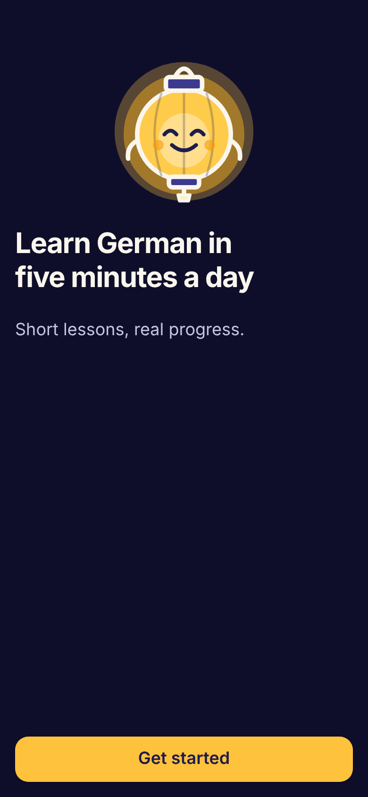 | 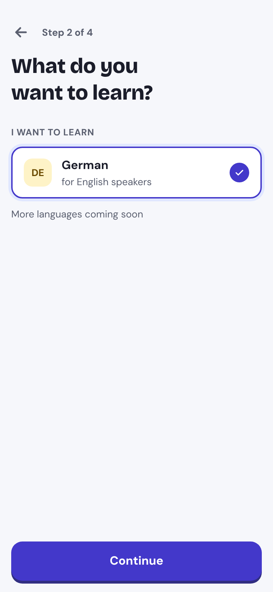 | 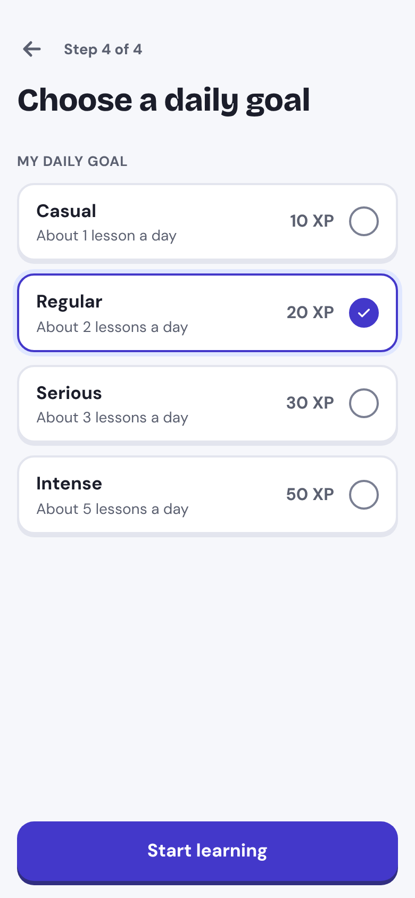 |

[▶ Watch in full quality (MP4)](docs/media/onboarding.mp4)

### Play a German lesson

Every lesson opens with a short tip, then 10–12 exercises: multiple choice, match pairs,
word-bank translation in both directions and listening. Wrong answers come back at the end
of the lesson; the results screen shows XP, accuracy, time, your streak and the daily goal.

<p>
  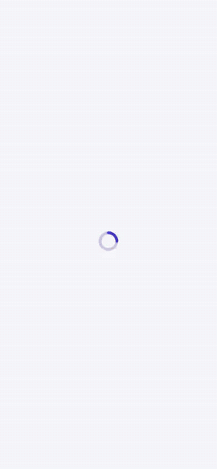
</p>

| Tip                                                                                  | Multiple choice                                                                                                  | Not quite                                                                                                | Match pairs                                                                                        |
| ------------------------------------------------------------------------------------ | ---------------------------------------------------------------------------------------------------------------- | -------------------------------------------------------------------------------------------------------- | -------------------------------------------------------------------------------------------------- |
| 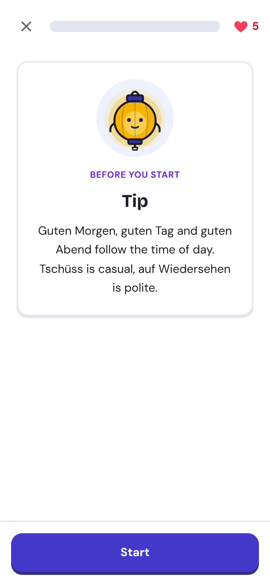 | 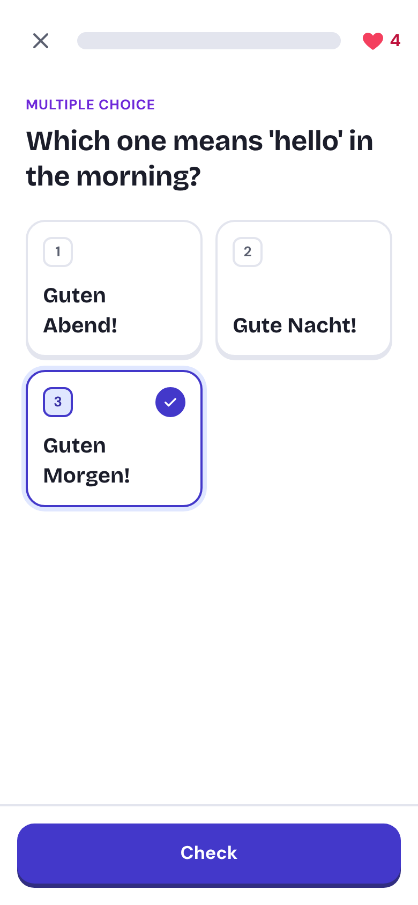 | 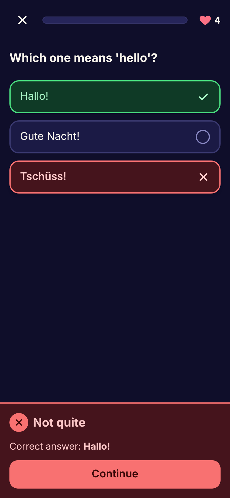 | 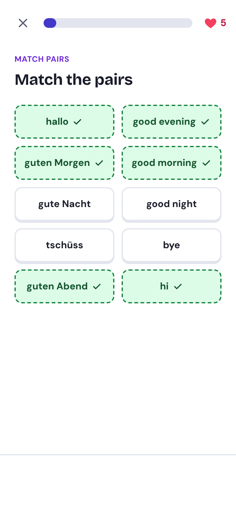 |

| Word bank                                                                                      | Listen                                                                                           | That's right!                                                                                        | Lesson complete                                                                                                             |
| ---------------------------------------------------------------------------------------------- | ------------------------------------------------------------------------------------------------ | ---------------------------------------------------------------------------------------------------- | --------------------------------------------------------------------------------------------------------------------------- |
| 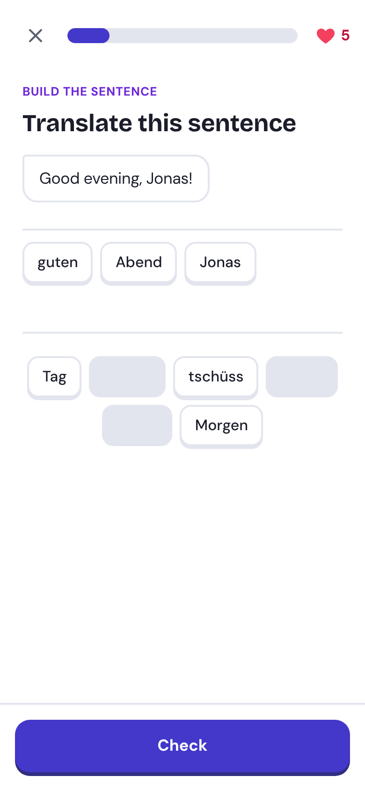 | 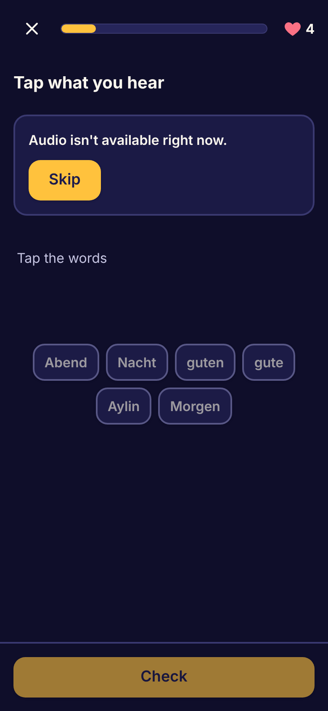 | 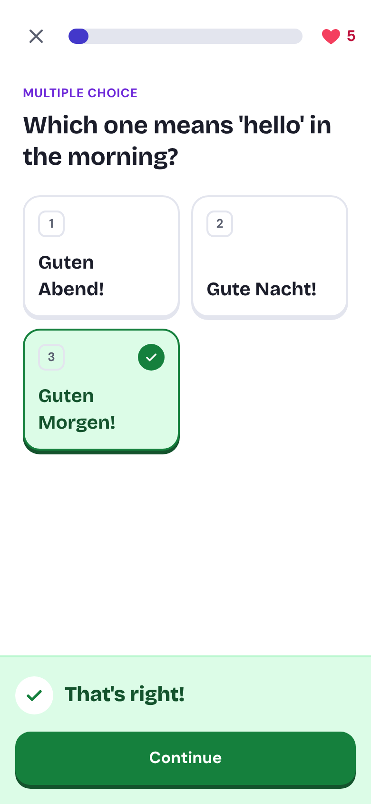 | 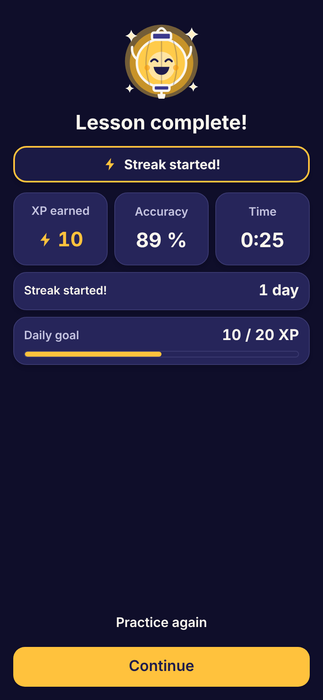 |

[▶ Full lesson (MP4)](docs/media/lesson.mp4)

_Listening exercises show "Audio isn't available" with a Skip button until recorded German
audio is added (waiting on a text-to-speech licence decision); skipping costs no heart._

### Skill path, top bar and navigation

The Learn tab is a skill path grouped by CEFR level and unit: finish a lesson to unlock the
next. The top bar shows your streak, XP and hearts. The app is an installable PWA that works
offline.

| Skill path                                                                  | After Lesson 1                                                                                  | Profile                                                                        | Offline                                                                      | Page not found                                                    |
| --------------------------------------------------------------------------- | ----------------------------------------------------------------------------------------------- | ------------------------------------------------------------------------------ | ---------------------------------------------------------------------------- | ----------------------------------------------------------------- |
| 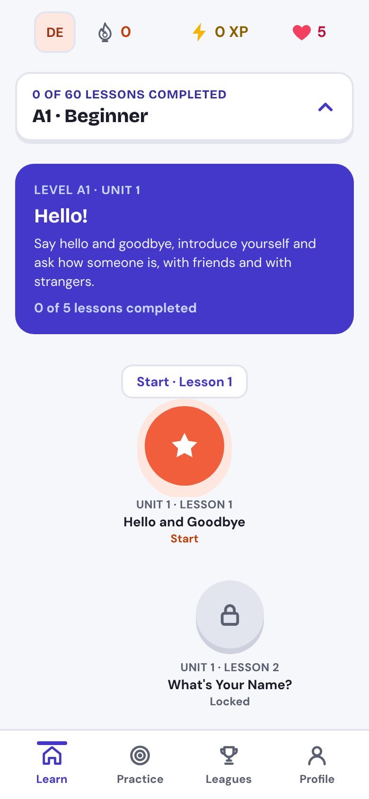 | 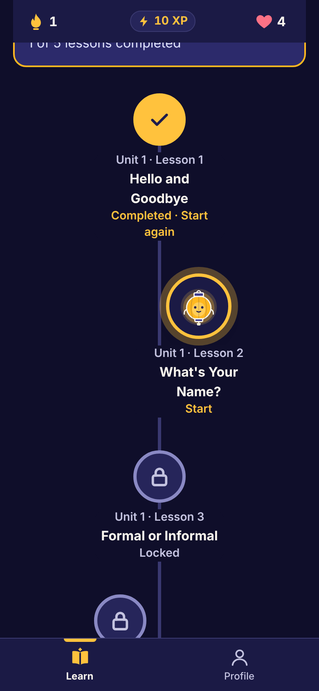 | 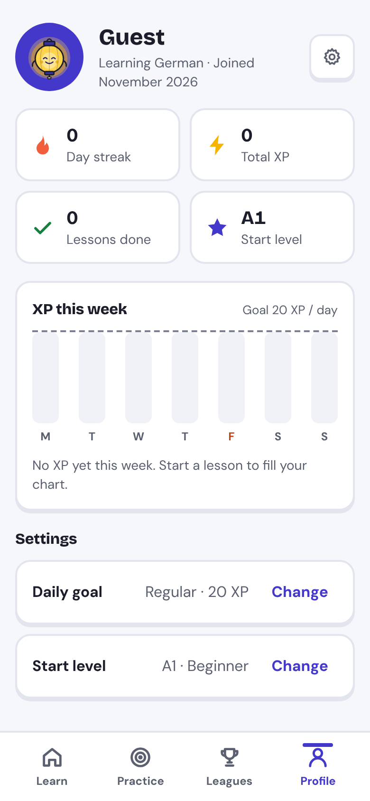 | 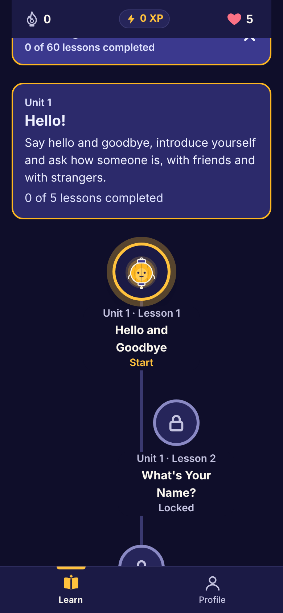 | 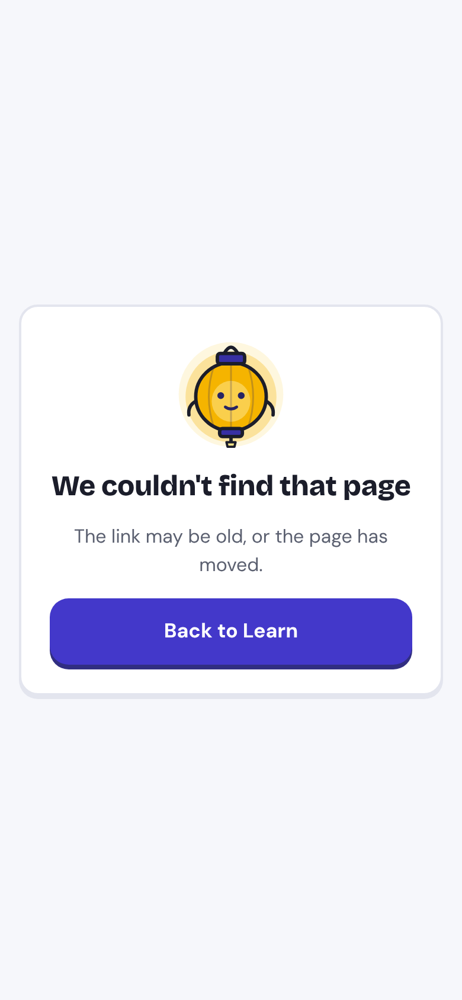 |

<p>
  
  &nbsp;&nbsp;
  
</p>

[▶ Tabs (MP4)](docs/media/tabs.mp4) · [▶ Offline (MP4)](docs/media/offline.mp4)

### The German course

- **A1 (complete):** 12 units, 60 original lessons and about 700 exercises, from greetings to
  appointments, shopping, the doctor and registering an address, ending in an A1 checkpoint.
- **A2 (in progress):** Units 1–4 are on `main` (weather, the past, holidays, invitations);
  Units 5–14 are written and in review (see below).
- All content is original and written to our own content standard (umlauts and ß are
  real letters, both `du` and `Sie` are taught, answers accept every natural word order).

---

## Coming next (written, in review)

- **German A2 Units 5–14** and the A2 checkpoint: errands, clothes, health, phone calls,
  home and neighbours, train and hotel, work, letters and offices, media and comparisons,
  plans for the future. That's 50 more lessons, followed by a full A2 QA pass.
- **German voice fallback and long-word tiles** (LES-014).
- Then B1 → C1, and accounts with sync (v0.4.0, paused while German ships).

---

## Roadmap

| Version | Goal                                                   | Status                     |
| ------- | ------------------------------------------------------ | -------------------------- |
| v0.1.0  | MVP foundation: app shell, PWA, guest mode, onboarding | released                   |
| v0.2.0  | First playable lesson: lesson engine, 4 exercise types | released                   |
| v0.3.x  | German A1: 60 lessons, CEFR skill path, tip cards      | content done, release next |
| v0.4.0  | Accounts and sync (Supabase), profile and settings     | paused                     |
| v0.5.0  | German A2: 70 lessons                                  | in review                  |
| v1.x    | German B1, B2, C1                                      | planned                    |

Details: [`docs/product/ROADMAP.md`](docs/product/ROADMAP.md) · Live status:
[`docs/STATUS.md`](docs/STATUS.md)

## Tech stack

Next.js (App Router) · React · TypeScript (strict) · Tailwind CSS · Serwist (service
worker) · Dexie (IndexedDB) · TanStack Query · Zustand · Supabase · Zod · Vitest + React
Testing Library · Playwright

## Run it locally

```bash
npm ci
npm run dev          # http://localhost:3000
npm run test         # unit tests
npm run build        # production build (webpack, emits the service worker)
npm run test:e2e     # Playwright end-to-end tests
```

## Updating the screenshots and recordings

```bash
npm run build && npx next start -p 3200 &
BASE_URL=http://localhost:3200 node scripts/readme-media/capture.mjs   # PNGs + recordings
scripts/readme-media/encode.sh                                         # → GIF + MP4
```

Set `CHROMIUM_PATH` to use a specific Chromium, `ONLY=onboarding,lesson` to capture
selected flows, and `MEDIA_DIR=docs/media/preview` to capture an unmerged branch. The lesson
flow plays German Lesson 1 using the answers in its content file. New screens are added as a
flow in `scripts/readme-media/capture.mjs`.

## Project docs

- Product: [PRD](docs/product/PRD.md), [German market analysis](docs/product/market-analysis-german.md),
  [German curriculum](docs/product/curriculum-german.md), [decisions](docs/product/decisions.md),
  [tickets](docs/product/tickets)
- Architecture: [ARCHITECTURE.md](docs/architecture/ARCHITECTURE.md),
  [ADRs](docs/architecture/adr)
- How the agent team works: [CLAUDE.md](CLAUDE.md), [ORCHESTRATOR.md](ORCHESTRATOR.md)
